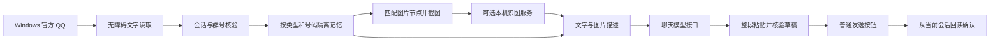

# 工作方式

- desktop.py：QQ 窗口、OCR、输入及停止键。
- read-qq-direct.ps1 / direct_reader.py：当前已加载消息、唯一重叠对齐、首次读取基线；不能取得全部历史。
- transport.py：会话定位、群号核验、草稿保护、发送与回读。
- read-qq-image.ps1 / uia_image.py：同一消息图片节点，完整视口及截图前后位置核验。
- memory.py：独立上下文、待处理消息、未确认发送记录。
- vision.py / reasoning.py / bot.py：本地识图、可选推理参数、聊天生成和多会话轮询。
- manager.py：监听名单的新增、修改、删除及启停。
- runtime.py：与平台无关的配置和请求数据构造。
- setup.ps1 / start.ps1 / stop.ps1：安装及当前用户的 QQWhaleBot 计划任务。

显示时间是首次观察时间，不能当作 QQ 原始发送时间。无法唯一对齐旧消息时建立新基线，避免把整屏历史重新回答；极忙群中可能因此漏读。

群核验缓存仅在目标、标题、QQ 窗口和进程创建时间匹配时复用。发送结果不确定时不会盲目自动重发。
