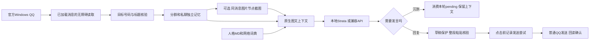

# 工作方式

## 模块

| 文件 | 职责 |
| --- | --- |
| desktop.py | QQ窗口、焦点、OCR、鼠标键盘、F8/STOP |
| read-qq-direct.ps1 / direct_reader.py | UIA文字、首次观察时间、唯一重叠对齐、基线 |
| read-qq-identity.ps1 / open-qq-identity.ps1 | 目标资料卡与号码核验 |
| transport.py | 搜索和切会话、核验缓存、草稿、发送和回读 |
| read-qq-image.ps1 / uia_image.py | 同一消息runtime_id、可视区域核验、前后几何一致性、截图与数量清理 |
| memory.py | 隔离scope、上下文、pending、uncertain发送记录、去重 |
| vision.py | 采集原生输入图片，不再请求独立千问描述 |
| native_vision.py | 选择最近相关图片、同scope路径限制、图文请求、图片摘要和静默规则 |
| runtime.py | 相对路径、API Key、通用/扩展请求参数 |
| bot.py / reasoning.py | 单轮生成、medium/high策略、多会话轮询与重试 |
| manager.py | 监听名单新增/修改/改名/删除/启停，打开时暂停bot |
| bridge.py | 面向外部程序的JSON read/prompt/send/ack |
| deployment/ | 固定模型文件、断点续传、pack、后台模型任务 |

## 时序与边界

文字来自当前QQ实际暴露的UIA节点，不是数据库全量同步。重复图/重复文本造成重叠不唯一时会重新建基线，避免将整屏旧消息当新消息；代价是可能漏读忙群内容。

图片通过相同会话、相同消息的runtime_id绑定，不靠缓存目录里“最新的一张”猜来源。节点消失、会话不符、滚动后仍被裁切或窗口位置变化均拒绝取图。截图结束尽量恢复最新消息。运行时只附最近一张相关图片；旧Qwen描述不会进入新prompt。

模型一次完成理解和是否发言的选择。未读图片无人提问时可静默；明确问图则简短说明未读到。不会把“没读到”编成“图很糊”。已看过图片只保留短摘要哈希，并不把Base64塞进memory.json。

发送前持久化uncertain记录，防止点过按钮但回读失败后再次回复旧内容。confirmed表示从当前会话看到了匹配正文；它仍是界面确认，不是QQ服务器回执。

默认mutex同时兼顾旧版AIchatVisualBot和公开版QQWhaleBot，避免两套脚本争抢同一QQ桌面。JSON桥接临时取得相同排他控制，结束恢复原STOP状态。部署/模型服务本身不操作QQ。

原生模型方案、CPU/GPU/SSD分工见 [LOCAL_AI.md](LOCAL_AI.md)；对外契约见 [INTEGRATION.md](INTEGRATION.md)。
